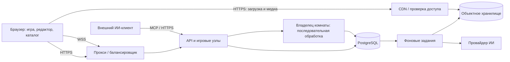

# Архитектура, синхронизация и нагрузка

**Статус:** проект решения. Производительность не измерена; значения в требованиях — бюджеты для прототипа. Архитектура рассчитана на публичное сообщество, с изоляцией пользовательских пакетов и комнат.

## 1. Выбор стека

| Компонент | Предложение | Обоснование и условие пересмотра |
|---|---|---|
| Интерфейс | SvelteKit + TypeScript | Компиляторный подход, разделение маршрутов; каталог — SSR, игра — интерактивный клиент. Выбор подтвердить размером сборки и тестами на телефонах |
| Альтернатива UI | React + Vite/SSR-фреймворк | Уместен при сильной React-команде; отказ от него не является доказательством ускорения |
| Игровой сервер/API | Rust + Tokio + Axum | Управление памятью без tracing GC, асинхронный I/O; требует опыта и ограниченных очередей |
| Альтернатива сервера | Go | Удобное сопровождение; GC и выделения измеряются на той же нагрузке |
| Данные | PostgreSQL | Пользователи, публикации, версии, права, задания и журнал игровых решений; полнотекстовый поиск на старте |
| Файлы | S3-совместимое хранилище + CDN | Оригиналы и производные отдельно; выдача по HTTPS с контролем доступа |
| Обработка | Отдельные процессы задач | Проверка архивов, преобразование медиа и ИИ изолированы от игрового процесса |
| Координация | PostgreSQL на старте | Владение комнатами и долговечные задания; Redis возможен позднее как кеш/presence, но не единственный источник счёта |

Svelte использует компиляцию; SvelteKit позволяет управлять SSR по маршрутам. Это свойства инструментов, а не сравнительный бенчмарк. [Svelte](https://svelte.dev/docs/svelte/overview), [SvelteKit](https://svelte.dev/docs/kit/page-options).

Rust использует модель владения памятью, Tokio — асинхронный runtime; Go предлагает настраиваемый сборщик мусора. Ни один из этих фактов не доказывает, сколько соединений выдержит наше приложение. [Rust](https://doc.rust-lang.org/book/ch04-01-what-is-ownership.html), [Tokio](https://tokio.rs/tokio/tutorial), [Go GC](https://go.dev/doc/gc-guide).

Решение о языке: одинаковый прототип комнаты на Rust и Go, одинаковые правила и durability, один стенд. Сравнить p99, RSS, CPU, скорость разработки и эксплуатацию. Если оба проходят бюджеты, выбирать по компетенции команды и стоимости сопровождения. Библиотеку SIPackages на .NET отдельно оценить для импорта/эталонного сравнения.

## 2. Границы системы

Начальная структура — модульный сервер с отдельными процессами тяжёлых задач. Модули: identity, packages, catalog, rooms, moderation, AI/MCP. Контракты не требуют немедленного выделения каждого модуля в микросервис.

Основные сущности: User, GuestSession, Pack, PackVersion, Asset, SourceRecord, RightsRecord, Room, Participant, RulesetVersion, GameEvent, AIJob, ModerationCase. Комната ссылается на конкретные версии пакета и правил. Содержимое опубликованной версии не изменяется.

## 3. Транспорт и формат сообщений

**WebSocket/WSS** — команды и события игры; **HTTPS** — каталог, редактор, загрузки, медиа и MCP. Начать с небольших JSON-сообщений и версионированной схемы; MessagePack/Protobuf рассматривать по замерам, а не по моде.

WebSocket имеет широкую поддержку, но браузерный API не решает управление переполнением очередей автоматически. Это обязанность приложения. [MDN WebSocket](https://developer.mozilla.org/en-US/docs/Web/API/WebSockets_API).

WebTransport предлагает независимые потоки и датаграммы; на дату исследования MDN относит его к Baseline 2026 с оговорками о старых браузерах. Поэтому неверно считать его повсеместно недоступным. Для наших небольших упорядоченных команд его дополнительная сложность пока не обоснована. [MDN WebTransport](https://developer.mozilla.org/en-US/docs/Web/API/WebTransport).

Команда содержит версию протокола, ID команды, комнату, ожидаемую фазу/вопрос и полезную нагрузку. Личность определяется серверной сессией. Событие содержит номер последовательности, эпоху владельца комнаты, серверное время и разрешённые конкретной роли данные. Клиент подтверждает последний применённый номер.

Не отправляем таймер 60 раз в секунду: передаём момент окончания и редкие поправки. Каждые 15 секунд проверяем живость соединения; после двух пропусков помечаем разрыв. Восстановление — с экспоненциальной задержкой и случайным разбросом, чтобы не перегрузить вход.

## 4. Игровая истина и порядок нажатий

В каждый момент у комнаты один владелец. Он последовательно обрабатывает команды и меняет состояние: лобби → выбор → подготовка медиа → показ вопроса → приём нажатий → ответ → решение → следующее действие → результаты. Спецвопросы добавляют состояния ставок и передачи вопроса.

Для режима первого поступления:

1. Сервер открывает фазу с ID вопроса и временем начала.
2. Владелец комнаты принимает только допустимые нажатия текущей фазы.
3. Первый принятый запрос фиксируется в общем порядке событий; одинаковые часы не создают ничью, порядок задаёт очередь.
4. Победитель сохраняется до подтверждения клиентам; повтор с тем же ID возвращает прежний результат.
5. Ведущий может отменить решение отдельным событием с причиной.

Порядок соответствует поступлению к владельцу комнаты, а не физическому моменту нажатия на разных устройствах. Малый RTT даёт преимущество; абсолютное равенство в интернете не обещается. Время клиента используется для диагностики, не для авторитетного выбора победителя.

Опциональный дружеский режим собирает уникальные нажатия в окне 100–300 мс после первого и случайно выбирает одного участника. Правило и длина окна видны заранее; победитель записывается, а не выбирается заново при восстановлении. Этот режим тоже не устраняет всю разницу сетей.

Дедлайны внутри процесса используют монотонные часы; для восстановления сохраняется согласованное временное представление. Закрытые ответы и ставки выдаются только после фазы раскрытия. Зрители не получают приватную проекцию ведущего.

## 5. Переподключение и отказ узла

WebSocket сам по себе не даёт восстановления сессии после разрыва. При возврате клиент передаёт последнюю последовательность; сервер возвращает пропущенные события либо снимок разрешённого состояния. Устаревшие команды не переигрываются автоматически в новой фазе.

Критические решения и ID команд хранятся в PostgreSQL. Подтверждение означает успешную запись согласно выбранной политике долговечности. Событие не рассылается как принятое до этого момента. Снимок создаётся на границах вопросов, журнал позволяет восстановить последующие изменения.

На нескольких узлах реестр хранит владельца и возрастающую эпоху комнаты. Запись проверяет эпоху и ожидаемый номер события транзакционно: прежний владелец после смены не может продолжить запись. При недоступности БД комната приостанавливает решения. Для failover БД и заявленного RPO отдельно выбирается политика репликации.

После потери владельца новая копия восстанавливает комнату и ставит активный вопрос на паузу; ведущий явно продолжает. Гарантия без потери подтверждений относится к сбою процесса; потеря площадки имеет отдельные RPO/RTO из требований.

Маршрутизация привязывает соединения комнаты к владельцу; балансировка по отдельным сокетам недостаточна. Перемещение занятой комнаты — управляемая операция с остановкой приёма и восстановлением. Кеш или Pub/Sub не заменяют журнал.

## 6. Медиа и объём данных

Путь файла: потоковая загрузка → карантин → проверка контейнера и XML → извлечение с лимитами → анализ кодеков → при необходимости производные версии → публикация манифеста. Игра начинается только с подготовленной версией пакета.

Оригинал сохраняется для экспорта. Изображения, аудио и видео оптимизируются отдельно; нельзя ухудшать детали, важные для вопроса. Автор получает предпросмотр производной версии. Видео отдаются с поддержкой диапазонов байтов; адаптивный стриминг добавляется, если тесты длинных файлов его оправдают.

Браузер скачивает выбранный вопрос, а не весь `.siq`. После готовности игроков сервер назначает ближайшее общее время показа; при ожидании свыше 10 секунд ведущий видит выбор: ждать, пропустить или продолжить с уведомлением. В экономном режиме загружается только необходимое; объём виден заранее.

Правильный ответ и медиа ответа не выдаются до раскрытия. URL не содержат подсказок в имени. Любая информация, уже доставленная клиенту, технически доступна пользователю: поэтому предварительная загрузка будущих вопросов ограничена.

Публично скачиваемый пакет нельзя защитить от предварительного изучения. Для соревновательной игры нужен непубличный пакет с ограничением экспорта, но и это не мешает участникам записывать уже показанные вопросы.

Хеширование помогает не хранить одинаковые байты несколько раз, однако доступ проверяется независимо от хеша. CDN обязан проверять разрешение до выдачи кешированного объекта; приватные данные не попадают в публичный кеш. Отзыв публикации блокирует новую выдачу и запускает очистку кеша; уже скачанное отозвать невозможно.

## 7. ИИ и MCP

ИИ-провайдер генерирует содержимое. **MCP — интерфейс доступа ИИ-клиента к инструментам нашего сервиса**, а не модель и не самостоятельная гарантия качества. Встроенный помощник может вызывать тот же прикладной слой без обязательного сетевого MCP-перехода. [Архитектура MCP](https://modelcontextprotocol.io/specification/2025-11-25/architecture).

Начальный MCP-контракт: `create_draft`, `get_draft`, `upsert_questions`, `validate_draft`, `export_siq`. Изменения требуют ожидаемой версии черновика и ключа идемпотентности. Транспорт — Streamable HTTP поверх HTTPS; протокол согласуется с клиентом. [Транспорт](https://modelcontextprotocol.io/specification/2025-11-25/basic/transports).

Поток генерации: аудитория/тематика/сложность → план тем → вопросы в структурированной форме → проверка обязательных полей и повторов → проверка источников → ревью автора → предпросмотр → обычная публикация. Проверяющая модель может помогать, но не считается независимым подтверждением факта.

Для вопроса храним источник, дату проверки, статус фактчекинга и происхождение генерации. Фиктивная ссылка не превращает ответ в проверенный. У неуверенного результата виден статус, а включение в опубликованный пакет требует решения автора.

Доступ MCP ограничен пользователем и областью действия токена. У каждого задания лимит стоимости, отмена и история; ключи провайдера хранятся на сервере. Тексты источников и пакетов — недоверенные данные: они не могут расширить полномочия, вызвать публикацию или получить секреты. Публичной публикации через инструменты MVP нет. Это наше продуктовое ограничение поверх модели [MCP tools](https://modelcontextprotocol.io/specification/2025-11-25/server/tools).

## 8. Проверка нагрузки и стоимости

**Предлагаемый стенд:** 3 игровых/API-узла по 4 vCPU / 8 GiB; отдельная PostgreSQL 4 vCPU / 8 GiB с SSD; отдельный worker 4 vCPU / 8 GiB; прокси и объектное хранилище учитываются отдельно. Это конфигурация испытаний, не доказанная минимальная инфраструктура и не готовая HA-схема БД.

**Профиль NFR-01:** 1 000 комнат × 10 соединений = 10 000; в каждой ведущий, 5 игроков и 4 зрителя. Для проверки верхних лимитов отдельно тестируются комнаты по 29 участников и горячие группы. Одна большая комната на 10 000 зрителей — другой сценарий.

Основной профиль: в среднем 2 команды/с на комнату, 2 рассылаемых события/с размером 400 байт на получателя; дополнительно 100 поисковых запросов/с. Всплеск — 5 000 нажатий за 100 мс. Параллельно работают 2 ограниченные задачи обработки пакетов и 20 ожидающих ИИ-заданий; задаётся реальная пропускная способность провайдера.

Оценка полезной нагрузки: `1 000 × 10 × 2 × 400 = 8 МБ/с` исходящих событий. Заголовки, TLS, heartbeat и снимки увеличат результат. Медиа считаются отдельно: `6 000 × 1 Мбит/с = 6 Гбит/с` при одновременном воспроизведении видео. CDN разгружает origin, но не отменяет клиентский трафик и расходы.

Тесты: постепенный набор → час целевой нагрузки → 8 часов на рост памяти → всплеск нажатий → разрыв 30% соединений и массовый возврат → потеря узла → задержки БД/CDN → восстановление. При сбое узла показатели времени берутся из NFR-04, а не из нормального NFR-02.

Измерять CPU, RSS, память сокетов, выделения/GC, очереди, пропускную способность записи, p50/p95/p99, ошибки и расхождения состояния. Генераторы работают на отдельных машинах; дополнительно нужны настоящие браузеры и мобильные сети. Часть испытаний проводится с RTT 50/100/200/400 мс и потерями до 3%.

Подбирать размер пула БД, таймауты прокси, число файловых дескрипторов и лимиты очередей по профилю. Отключённый/медленный клиент не должен удерживать бесконечный буфер. При перегрузке сначала ограничиваются новые комнаты и фоновые задачи, действующие игры получают приоритет.

Экономика считается формулой: серверы + БД/backup + ГБ-месяц оригиналов и производных + ГБ доставки + запросы хранилища + ИИ + модерация. Например, **100 000 пакетов × 50 МБ = 5 ТБ оригиналов** до производных и копий; обе величины здесь гипотетические.

## 9. Защита открытого сервиса

Нужны проверка Origin при WebSocket-handshake, авторизация каждой команды, защита HTTP от CSRF, лимиты входа и создания комнат, отзыв приглашений, исключение/блокировка участников, защита от массовых гостевых подключений. CAPTCHA вводится при признаках злоупотребления, не обязательно для каждого входа.

Архивы защищаем от обхода путей и чрезмерной распаковки; XML — от внешних сущностей; внешние URL — от SSRF, включая перенаправления и смену DNS. Обработчики медиа запускаются с ограничениями CPU/памяти/времени и без произвольного доступа к сети. HTML и скрипты из пакетов не исполняются.

Для открытого каталога обязательны модераторская очередь, возрастные отметки, журнал решений и процедура удаления. До запуска определяется юрисдикция, сроки хранения и регион персональных данных. Резервное копирование считается работающим только после успешного восстановления.
